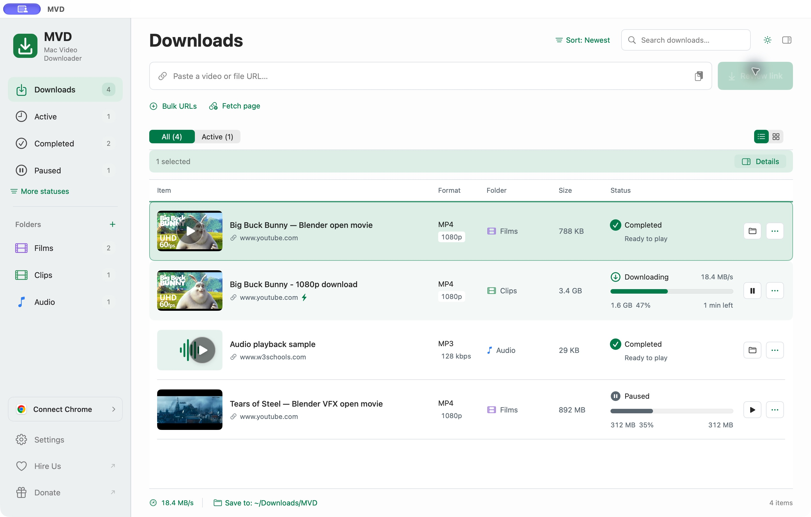
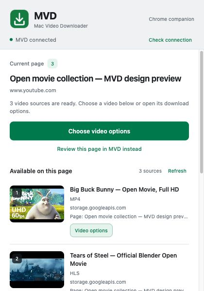
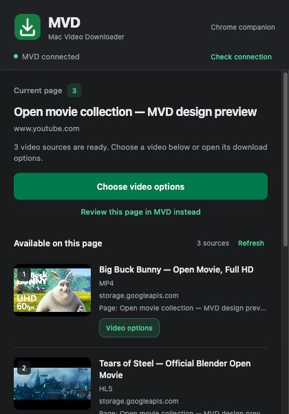

# Mac Video Downloader - Download from anywhere.

Paste a link. Pick the quality. Save it where you want.

**MVD** is a native Mac download manager for supported video pages, HLS/DASH streams, audio, and direct files. It brings real quality and format choices, a persistent download queue, and a Chrome companion into one clean library.

<p>
  <a href="https://github.com/kwebby/mac-video-downloader/releases/download/v0.4.4/MVD-0.4.4-arm64.dmg"></a>
  <a href="https://github.com/kwebby/mac-video-downloader/releases/download/v0.4.4/MVD-Chrome-Installer-0.4.4.zip"></a>
</p>

**Requires macOS 14 or later and an Apple Silicon Mac.** The release includes its media tools, so you can install it without Homebrew, Python, or developer tools. Current version: **0.4.4, build 10**.

[Getting started](Documentation/getting-started.md) · [Step-by-step tutorials](Documentation/tutorials.md) · [Releases](https://github.com/kwebby/mac-video-downloader/releases) · [Source available license](LICENSE)

## A quieter download library

<picture>
  <source media="(prefers-color-scheme: dark)" srcset="Documentation/Screenshots/library-dark.png">
  
</picture>

MVD gives your downloads some breathing room. See thumbnails, play completed videos from their artwork, find files by folder, and switch between list and grid views. Choose Light, Dark, System, or a Custom appearance with your own colors and fonts.

Screenshots use a demo library and a mock browser connection, not personal downloads. [Screenshot details and image credits](Documentation/Screenshots/README.md).

## What you can do

- **Choose real video quality.** Review the resolutions and source formats a video actually offers, including 720p and 1080p when available.
- **Save video or audio your way.** Keep video with audio, save silent video, or extract audio as Original, M4A, MP3, Opus, WAV, or FLAC. Compatible lossy formats offer a bitrate choice.
- **Queue several links together.** Bulk URLs handles up to 50 unique links with separate quality, output, and folder choices.
- **Keep things organized.** Pick a default download location and create folder shortcuts with names, colors, and icons.
- **Download from the browser.** The Chrome companion shows numbered videos, thumbnails, page titles, and a Download this video button on detected players.
- **Stay in control.** Pause, retry, cancel, inspect, reveal in Finder, and use acceleration where the source supports parallel transfers. Accepted downloads keep running after you close the interface.

Website support depends on the provider and the source a player exposes. YouTube, Vimeo, and many other public providers can work through the media engine, while some authenticated or opaque players remain unavailable. DRM-protected playback and general WebRTC capture are unsupported. Kling AI downloads haven't been verified yet. See [compatibility and troubleshooting](Documentation/tutorials.md#when-a-video-will-not-download).

## Install MVD

1. [Download the DMG](https://github.com/kwebby/mac-video-downloader/releases/download/v0.4.4/MVD-0.4.4-arm64.dmg).
2. Open it and drag **MVD** into **Applications**.
3. Open MVD, paste a supported link, and click **Review Link**.
4. Choose your quality, format, and folder, then click **Download**.

Or use the terminal installer:

```sh
curl -fsSL https://raw.githubusercontent.com/kwebby/mac-video-downloader/main/Scripts/install.sh | bash
```

The installer downloads the latest release, verifies its checksum, and installs the app. The [setup guide](Documentation/getting-started.md#install-from-terminal) also covers downloading the script first or fetching the DMG manually.

Prefer a manual download?

```sh
curl -fL https://github.com/kwebby/mac-video-downloader/releases/download/v0.4.4/MVD-0.4.4-arm64.dmg -o MVD-0.4.4-arm64.dmg
open MVD-0.4.4-arm64.dmg
```

Use the [manual checksum steps](Documentation/getting-started.md#install-from-terminal) to compare the DMG with the release's published hash.

The v0.4.4 release assets are [MVD DMG](https://github.com/kwebby/mac-video-downloader/releases/download/v0.4.4/MVD-0.4.4-arm64.dmg), [complete Chrome installer bundle](https://github.com/kwebby/mac-video-downloader/releases/download/v0.4.4/MVD-Chrome-Installer-0.4.4.zip), [extension runtime ZIP](https://github.com/kwebby/mac-video-downloader/releases/download/v0.4.4/MVD-Companion-0.4.4.zip), and [SHA256SUMS.txt](https://github.com/kwebby/mac-video-downloader/releases/download/v0.4.4/SHA256SUMS.txt).

## Connect Chrome

Click **Connect Chrome** in MVD's sidebar. The app prepares its companion and opens the setup steps. In Chrome, enable **Developer mode** at `chrome://extensions`, choose **Load unpacked**, and select the folder MVD reveals. Open the companion popup once to finish connecting.

A green tick appears after a recent successful handshake with the matching desktop app. Chrome asks you to approve the extension and any optional website access. The companion follows the browser's preferred light or dark appearance.

<p>
  
  
</p>

Choose a video in the popup or click **Download this video** on its player. Pick the real source format, audio settings, and saved folder before downloading. Once MVD confirms the job, the desktop app comes forward and selects it. This opens the accepted download without adding another copy.

[Full Chrome setup and website controls](Documentation/getting-started.md#connect-the-chrome-companion)

## Learn the useful bits

| I want to… | Start here |
|---|---|
| Download my first video | [First video](Documentation/tutorials.md#download-your-first-video) |
| Save an MP3 at 128 kbps | [Audio-only download](Documentation/tutorials.md#save-an-mp3-at-128-kbps) |
| Save video without sound | [Silent video](Documentation/tutorials.md#save-a-video-without-audio) |
| Queue links and organize folders | [Bulk URLs](Documentation/tutorials.md#download-several-links-together) and [folders](Documentation/tutorials.md#organize-downloads-with-folders) |
| Use browser buttons or disable one website | [Chrome controls](Documentation/tutorials.md#use-the-browser-companion) |
| Set up a proxy or try the speed button | [Proxy](Documentation/tutorials.md#use-a-media-proxy) and [acceleration](Documentation/tutorials.md#try-download-acceleration) |
| Inspect or work on the code | [Development notes](Documentation/development.md) |

## Made by Ramanpal Singh

MVD is built by [Ramanpal Singh at Kwebby](https://kwebby.com). Need a custom app, website, or help with your project? [Hire us](https://kwebby.com/services).

If MVD is useful to you, you can [buy us a little more building time](https://checkout.dodopayments.com/buy/pdt_0NqDCEkv5kQm3ei5prGCE?quantity=1).

<p>
  <a href="https://kwebby.com/services"></a>
  <a href="https://checkout.dodopayments.com/buy/pdt_0NqDCEkv5kQm3ei5prGCE?quantity=1"></a>
</p>

## Source available

You can inspect MVD's source, build it unchanged, and use the official app for personal or internal use under its [reserved-rights license](LICENSE). Modification, redistribution, rebranding, and resale require permission. Third-party components retain their separate licenses and notices.
