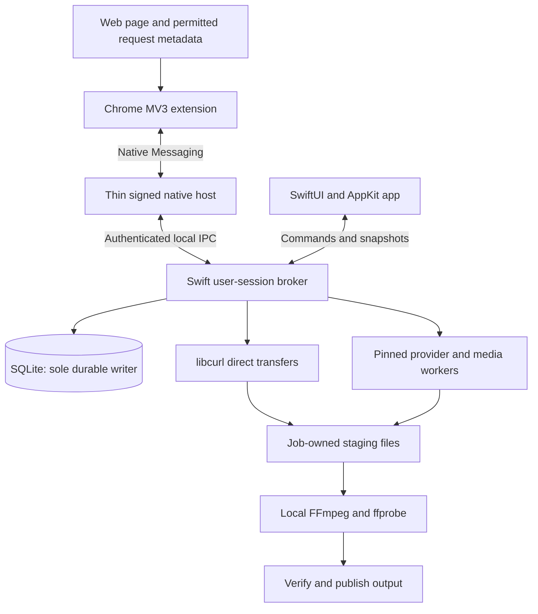

**2026-10-21  -  Research baseline. Implementation has started; see [README.md](README.md) for the current build, verified capabilities and remaining milestones. No implementation or performance results were claimed during the original planning phase.**

**Implementation scope update:** the app is named MVD  -  Mac Video Downloader. The private, unpacked v0.4 companion includes explicit YouTube media review/download at the user's request; the store-limited extension discussed below remains a separate distribution proposal.

**v0.4.2 qualification update:** completed media has Play controls, native audio preview and default-app video opening. The companion recognizes selected LinkedIn post/player sources and filters playback fragments. A public LinkedIn sample passed an exact-format native bridge download with FFprobe-verified MP3 output. All 13 download integration cases and 60 extension tests pass; these tested cases do not establish universal website support. See README for current behavior and limits.

# MVD  -  Mac Video Downloader

Build an IDM-class macOS application named **MVD  -  Mac Video Downloader**, with a native working interface, dependable file downloads, supported Internet video, and a Chrome companion. The recommended architecture is **SwiftUI + AppKit, a long-lived Swift user-session broker, libcurl for direct files, pinned yt-dlp with its matching EJS/runtime dependencies for supported providers, and FFmpeg/ffprobe for media assembly and inspection**. This is achievable as a maintained product; “every playable video from every website” is not an achievable support promise. Browser discovery, authorization, independent request replay, media processing, and store distribution each impose separate limits. In particular, current Chrome Web Store guidance identifies facilitating YouTube downloads as a rejection/removal reason, so a universal YouTube-download extension is a distribution blocker, including when it delegates downloading to the desktop. Recommend Developer ID distribution for the desktop, a genuinely policy-compatible Chrome extension, and a separately scoped standalone URL-paste capability. The architecture and roadmap below are recommendations; compatibility and effort remain unproven until the listed implementation experiments pass.

## 1. Define broad capability without promising universal capture

### Product goals and default decisions

The product should combine IDM's useful download-management workflows with native Mac behavior: add a URL, collect links from a page, detect supported media in Chrome, choose quality/audio/subtitles, send a job to the desktop, resume safely, organize queues, schedule work, and select proxies. Its advantage should be reliability, clear source recovery, efficient keyboard operation, and understandable status. Copy functional concepts, not IDM's name, branding, assets, or interface.

| Decision | Proposed default | Reason or remaining gate |
|---|---|---|
| Platform | macOS 14+; Apple silicon and Intel | Planning assumption; confirm audience and tool compatibility before committing |
| Browser | Chrome first | Other Chromium browsers and Safari are later integrations with separate installation/testing |
| Desktop distribution | Developer ID signed, notarized direct download | Best initial fit for native-host registration and bundled provider tools |
| Extension distribution | Chrome Web Store for its genuinely permitted scope | Submission/review is a gate; no acceptance guarantee |
| Network model | Local downloads; no media relay server or mandatory account | Keeps transfer cost, browser context, and private URLs on the user's Mac |
| Initial protocols | HTTP(S), progressive media, tested HLS VOD and static DASH | FTP/FTPS, live recording, complex manifests follow separately |
| Initial authentication | Public sources first; explicitly scoped session-assisted pilot | A browser login does not establish transferable desktop authorization |
| Incognito | Disabled in the initial extension | A later split-mode implementation needs separate history, secret, and isolation tests |
| Automatic takeover | Opt-in, conservative, replayability-gated | Preserve the browser download until the desktop can take responsibility |
| Output | Original-quality stream copy where possible | Container choice must match codecs; conversion is a separate explicit feature |
| Background operation | Approved per-user broker; ordinary user privileges | Accepted jobs must survive Chrome and UI exits |
| Naming/commercial model | MVD  -  Mac Video Downloader; green download mark | Name and icon selected during implementation; pricing remains open |

There is no evidence yet for a success percentage, fixed speed multiplier, or particular site working in this app. Publish a dated capability matrix after real tests, with discovery, resolution, authentication, transfer, and final output measured separately. Upstream yt-dlp itself warns that listed extractors can stop working as sites change. ([yt-dlp supported-sites disclaimer](https://github.com/yt-dlp/yt-dlp/blob/master/supportedsites.md))

### Media and website support contract

| Input or playback type | Intended support and first milestone | Boundary |
|---|---|---|
| HTTP(S) files; direct MP4/WebM/audio | MVP: direct URL, ranges when safe, pause/resume, retry, integrity checking | Server behavior and replayable authorization determine resumability |
| HLS VOD | v1: tested master/media playlists, TS/fMP4, variants and alternate audio | Only qualified manifest features; not every playlist/player combination |
| Ordinary AES-128 HLS | v1 pilot after key/IV/rotation fixtures | Only ordinarily accessible, authorized keys; no inaccessible-key or DRM circumvention |
| Static unencrypted DASH | v1: selected representations, separate audio/video, initialization data | Complex multi-period/addressing cases require separate qualification |
| YouTube pages/playlists | Conditional standalone desktop provider support | EJS/runtime, required access state, site changes, and source terms affect availability; YouTube facilitation is excluded from the proposed store extension |
| Vimeo | Public supported-provider cases and owner-authorized links | Private/embed/account cases require explicit tests and authorization; no blanket Vimeo guarantee |
| Logged-in MP4/HLS/DASH | Qualified session-assisted sources after public-source baseline | Cookies, signatures, IP binding, partitioning, and browser-only tokens can prevent replay |
| `blob:` / MSE playback | Locate an underlying authorized HTTP file/manifest when discoverable | The blob URL itself is not portable; MSE is not proof of DRM |
| Single webpage | MVP/v1: static links/media/recognized embeds; current-page extension assistance | JavaScript-generated content is not necessarily available to a static fetch |
| Site grabber | Later parity: bounded crawl with filters, preview and independent exploration/download controls | Not a complete interactive offline copy of arbitrary websites |
| HLS live | Later: explicit record/stop, rolling-window ledger, gap reporting | Cannot recover segments absent from the retained server window |
| LL-HLS / dynamic or low-latency DASH | Later experimental qualification | Ordinary VOD support does not establish these capabilities |
| DRM/EME/Widevine/FairPlay | Detect/classify where possible and explain unsupported state | No CDM extraction, license bypass, protected-buffer capture, or decryption-key acquisition |
| General WebRTC-only playback | Outside downloader scope | Real-time RTP tracks do not provide a general downloadable HTTP manifest/file |
| FTP/FTPS; SFTP; MMS | FTP/FTPS later parity; SFTP optional expansion; MMS legacy/deferred | Protocol-specific resume/authentication; no implied HTTP-equivalent behavior |

HLS and DASH describe track/segment structures, while MSE describes assembling browser playback and EME describes protected playback through key systems. They are different layers. A visible video element alone cannot tell the app whether a complete, independently fetchable output exists. ([HLS specification](https://www.rfc-editor.org/rfc/rfc8216.html), [DASH timing model](https://dashif.org/Guidelines-TimingModel/), [Media Source Extensions](https://www.w3.org/TR/media-source-2/), [Encrypted Media Extensions](https://www.w3.org/TR/encrypted-media/), [WebRTC specification](https://www.w3.org/TR/webrtc/))

### Distribution changes the browser feature scope

**Chrome Web Store is the main product constraint, not a minor packaging task.** Its troubleshooting guidance specifically names facilitating YouTube video downloads among prohibited-product rejection/removal reasons. Its broader policy also restricts unauthorized copyrighted-media access and restriction circumvention. Sending a YouTube URL to a native application for that purpose is still facilitation; moving the actual transfer outside the extension is not a workaround. ([Chrome Web Store troubleshooting](https://developer.chrome.com/docs/webstore/troubleshooting), [Malicious and prohibited products policy](https://developer.chrome.com/docs/webstore/program-policies/malicious-and-prohibited))

The store companion must have useful, fully disclosed, permitted discovery/download-management behavior and accurately disclose its desktop dependency. A listing that solely launches another app is also problematic. Desktop URL paste is a distinct capability, but its existence does not guarantee acceptance of the companion's actual behavior. Do not ship a hidden YouTube toggle, reviewer-only restrictions, or remotely added extraction logic. ([Store spam FAQ](https://developer.chrome.com/docs/webstore/program-policies/spam-faq), [Manifest V3 requirements](https://developer.chrome.com/docs/webstore/program-policies/mv3-requirements))

Regular consumer Chrome on macOS is **not** solved by distributing a self-hosted CRX: normal directly installable extensions must be store-hosted/signed. Unpacked loading is suitable for trusted personal/development testing. Enterprise self-hosting is a legitimate route only for genuinely managed enterprise installations, not a consumer installation trick. Maintain stable production extension IDs and explicitly separate development IDs. ([Chrome distribution options](https://developer.chrome.com/docs/extensions/how-to/distribute), [Alternative installation methods](https://developer.chrome.com/docs/extensions/how-to/distribute/install-extensions))

The Mac App Store is a separate question. Its sandbox, installation, executable-update, and third-party-media rules require a narrower authorized-media design and proof that the native bridge can be installed compliantly. Guidelines 2.4.5, 2.5.2, and 5.2.3 are directly relevant. A download manager is not categorically excluded, but this complete scope should start with direct distribution; notarization does not establish rights to download from a source. ([Apple App Review Guidelines](https://developer.apple.com/app-store/review/guidelines/))

## 2. Let one durable broker connect Chrome, native UI and workers

### Stack choice favors native integration and clear ownership

| Layer or alternative | Decision | Tradeoff |
|---|---|---|
| SwiftUI + AppKit | Recommended native shell; AppKit for table/drag/menu behavior where needed | Familiar Mac controls, accessibility and system integration |
| Swift broker/domain core | Recommended | One main language and direct access to Apple lifecycle/XPC APIs |
| libcurl direct worker | Recommended, subject to range/proxy comparison | Mature C networking capabilities; wrap callbacks, lifetimes and cancellation carefully |
| URLSession | Compare during the first spike | System networking/background features are valuable; they do not automatically cover provider subprocesses |
| SwiftUI + Rust core | Defer unless portability/team evidence justifies it | Adds FFI/build/event ownership work; useful for a committed cross-platform roadmap |
| Tauri + Rust | Viable alternative for a web/Rust team | Webview UI and native integrations need separate work |
| Electron | Viable alternative for an established web team | Adds Chromium/Node renderer and update responsibilities; benchmark before numerical resource claims |
| yt-dlp + matching EJS/runtime | Recommended provider/media worker | Maintained extractors avoid inventing a site ecosystem; compatibility remains ongoing work |
| FFmpeg / ffprobe | Recommended, pinned audited builds | Local muxing, stream inspection, structured processing events |
| aria2 | Exclude from baseline | A second queue/session system duplicates broker responsibilities; prototype only as a replacement worker if measurements warrant it |

Swift can use C APIs, libcurl's multi interface supports application-driven concurrent transfers, and native tables support selection/sorting. Tauri and Electron are legitimate architectural alternatives, not inherently incapable choices. The recommendation follows this Mac-first brief rather than unmeasured speed or memory claims. ([Swift C interoperability](https://developer.apple.com/documentation/swift/imported-c-and-objective-c-apis), [libcurl multi interface](https://curl.se/libcurl/c/libcurl-multi.html), [SwiftUI tables](https://developer.apple.com/videos/play/wwdc2021/10018/?time=777), [Tauri architecture](https://v2.tauri.app/concept/architecture/), [Electron process model](https://www.electronjs.org/docs/latest/tutorial/process-model))



**The broker owns every durable job and the single application scheduler.** A bundled per-user LaunchAgent registered through `SMAppService` runs as the logged-in user. It owns SQLite writes, transfer attempts, rate/connection allocation, subprocesses, secret references, checkpoints, retries and finalization. The UI submits commands and consumes coalesced snapshots; the Chrome-launched host frames and validates messages, then forwards them. Neither client writes the database. Provider workers schedule only their assigned job's fragments/tracks within a broker allocation. Apple documents service registration subject to user approval and supported code-signing requirements for XPC peer checks. ([SMAppService](https://developer.apple.com/documentation/servicemanagement/smappservice), [Apple XPC peer-validation guidance](https://developer.apple.com/forums/thread/681053))

Closing the main window leaves menu-bar access. Quitting the UI leaves approved background work running according to the user's chosen setting. Chrome exit, MV3 suspension or host exit must not terminate accepted jobs. “Quit all” checkpoints work, stops accepting new handoffs, cancels worker process groups cleanly, acknowledges quiescence and stops the broker without immediately relaunching it. If background registration is disabled or approval is missing, reject handoff clearly and offer repair. A temporary in-app engine experiment must not be advertised as completed background integration.

### Acquisition flows preserve provenance from discovery to publication

The recommended sequence is **discover → associate/deduplicate → capture scoped context → resolve → select → persist/acknowledge → transfer → assemble → verify → publish**. The same broker acquisition model serves Chrome, pasted URLs, webpage scans, collection enumeration and imports.

Discovery combines direct/context-menu links, DOM `video`/`audio`/`source`/`track` data, page metadata, permitted network request metadata and desktop provider extraction. Observe relevant media, XHR and other player traffic rather than assuming all manifests arrive as browser `media` requests. Check MIME/headers and conservative signatures; extensionless URLs are common. A candidate is evidence for investigation, not proof of a completed-download path.

Associate observations using browser-instance identity, tab, frame, document, navigation epoch, initiating origin and provider asset IDs. A player can have multiple video/audio renditions and hundreds of segment requests; show the logical asset and available choices. Use bounded per-tab registries, expire old documents, track SPA/back-forward changes and debounce DOM rescans. Never strip signatures from the actual URL or merge distinct signed renditions merely because their paths match. Display deduplication and transfer identity are separate concerns.

Resolution routes known provider pages to a maintained adapter, direct files to the direct engine, manifests to the media worker and unsupported pages to a clear result. Normalize original page, stable asset/provider identity, current URL/expiry, tracks, protection status, replayability, required context and transfer owner. Provider refresh must retain that identity instead of treating expiring media URLs as permanent recipes. Select quality, languages, subtitles, output container, destination, queue and network profile before starting, unless an explicit automatic rule supplies those choices.

### MV3 discovery needs actual page and media-origin access

Chrome `webRequest` exposes request lifecycle/header metadata, **not response bodies**, and ordinary MV3 store extensions lack blocking `webRequest`. Observation generally requires access to both requested and initiating origins; memory-cache traffic can be invisible. Some sensitive headers are absent and others need extra handling. Declarative rules are not a packet/body observer, and service-worker/CacheStorage behavior introduces separate visibility limits. ([webRequest reference](https://developer.chrome.com/docs/extensions/reference/api/webRequest), [Declarative Net Request reference](https://developer.chrome.com/docs/extensions/reference/api/declarativeNetRequest))

| Permission or context | Proposed use | Limitation to show in UI |
|---|---|---|
| `activeTab`, `scripting` | User-invoked current-page inspection | Temporary main-origin access does not grant every CDN or embedded player |
| `contextMenus`, `storage`, `nativeMessaging` | Explicit link/page actions, settings/outbox, desktop connection | Content scripts cannot invoke the native bridge directly |
| `webRequest` plus host access | Shipped passive media discovery | Request URL and initiator grants must exist; absent observations remain unknown |
| Optional HTTP(S) host grants | Current site plus justified player/CDN origins | A user gesture requests needed grants; missing CDN access is not magically inferred |
| Optional `cookies` | Selected session-assisted job | Requires host scope and correct cookie store/partition context |
| Optional `downloads` | Opt-in takeover of replayable browser downloads | Existing downloads have already started; full original request context is unavailable |
| Optional `webNavigation` | Document/SPA attribution if required | Frames/documents/navigation events need careful correlation |
| `debugger`, Chrome `proxy`, history | Excluded from baseline | Desktop proxies do not require changing Chrome's proxy settings |

Declare the narrowest implemented permissions and request optional origins incrementally. All-frame content scripts still need matching frame-origin access. Isolated scripts cannot read arbitrary page variables; a blob string does not expose buffered bytes. Restricted browser pages, past cached traffic, worker attribution and cross-origin iframes need honest unavailable states. Avoid always-on MAIN-world hooks and debugger access in v1; investigate narrowly scoped bundled hooks only if a real compatibility gap warrants them. ([activeTab](https://developer.chrome.com/docs/extensions/develop/concepts/activeTab), [Content scripts](https://developer.chrome.com/docs/extensions/develop/concepts/content-scripts), [Permissions API](https://developer.chrome.com/docs/extensions/reference/api/permissions), [Permission policy](https://developer.chrome.com/docs/webstore/program-policies/permissions), [webNavigation](https://developer.chrome.com/docs/extensions/reference/api/webNavigation))

### Native Messaging carries small commands with durable acknowledgments

Chrome launches native hosts over stdio using length-prefixed JSON. The manifest uses an absolute executable path and exact allowed extension origins. Use a persistent connection while an operation needs one, reconnect with bounded backoff and preserve required state beyond MV3 worker globals. This connection is not the download lifetime. Keep stdout protocol-only and send diagnostic output through controlled logging. ([Native Messaging](https://developer.chrome.com/docs/extensions/develop/concepts/native-messaging), [MV3 worker lifecycle](https://developer.chrome.com/docs/extensions/develop/concepts/service-workers/lifecycle))

| Conceptual message | Essential fields and behavior |
|---|---|
| Hello / capabilities | Protocol version, app/host/extension versions, compatible feature set, connection state |
| Resolve / list formats | Request ID, exact source URL, provenance, network-profile reference, optional scoped context reference; bounded metadata result |
| Enqueue | Idempotency key, asset/candidate identity, selected tracks/container, destination-profile and queue references, browser-instance/incognito identity, acquisition time |
| Accepted / rejected | Stable job ID only after durable broker commit and accepted usable context; structured reason/recovery on rejection |
| Query / subscribe | Job IDs, last event revision; bounded snapshot after gaps |
| Pause / resume / cancel | Job ID, command ID and intended action; validate current state and acknowledge outcome |
| Source refresh / context renewal | Original asset/document identity and one selected origin scope; no unrelated cookies |
| Error | Classified code, user-facing explanation, retryability, redacted detail, supported upgrade/repair action |

Set a stricter proposed application envelope cap, such as 256 KiB, with per-field/count limits. Parse byte lengths correctly, reject malformed/truncated frames and unknown types, and never stream media/base64 files through the bridge. Validate extension runtime sender/document/provenance, then host schema/origin, then broker IPC code identity and request policy. An origin string supplied on a command line is not by itself proof against arbitrary processes already running as the user. No webpage may provide executable paths, shell commands, arbitrary CLI flags or unrestricted output paths.

An enqueue retry with the same key returns the same logical job, including after a commit whose response was lost. Persist a nonsecret pending-action outbox; renew ephemeral secrets when needed. “Sent” means durable desktop acceptance. It does not mean the bytes will necessarily finish. For optional takeover, correlate a replayable HTTP(S) request, open/preflight it with usable context, obtain durable acceptance, and only then cancel Chrome. If absent, denied, ambiguous or timed out, leave Chrome running. Unknown POST/body, blob and session-bound cases stay browser-owned. Some duplicate bytes are an acceptable cost of preserving fallback. ([Downloads API](https://developer.chrome.com/docs/extensions/reference/api/downloads))

Install the app into a stable supported location before per-user host registration. The default Chrome user-data root has a `NativeMessagingHosts` directory; it is not inside `Default` or `Profile 1`. Profiles share host registration but need separate paired opaque instance identities and session contexts. Custom user-data roots and other Chrome channels/browsers require explicit supported-path handling. Repair stale absolute paths after app moves/reinstall/update, test the exact production ID, and remove only owned registrations on uninstall. No silent extension install or enterprise-policy changes.

### Session context and proxies form one explicit request policy

Start with public requests. Session assistance requires a deliberate selected-resource action and a scoped grant: exact URL/method when known, necessary safe headers, appropriate referrer, origin/frame context, acquisition/expiry information and minimally required cookies for approved hosts. Cookies include domain/path/security/store/partition semantics; a flat Cookie string or Netscape cookie file is not a faithful browser session. Do not grab the global browser cookie database, all-site cookies or saved passwords. Missing Authorization state, tokens, client certificates, browser/IP binding, service workers and anti-bot requirements can prevent native replay. ([Chrome cookies](https://developer.chrome.com/docs/extensions/reference/api/cookies), [Message-passing security guidance](https://developer.chrome.com/docs/extensions/develop/concepts/messaging))

Keep per-job session material ephemeral by default; persist only references and nonsecret job information. If restart loses context, the durable job moves to `waitingCredentials` or `waitingSourceRefresh` and asks the user to return to the page. Keychain stores retained user credentials/proxy passwords. Strip sensitive headers on unauthorized origin changes; separately authorize any CDN cookie context. Do not forward a page's full credentials to manifests, keys, subtitles and redirects indiscriminately. Redact query tokens, cookie/auth headers, proxy passwords and sensitive paths from diagnostics. ([Apple Keychain](https://developer.apple.com/documentation/security/keychain-services), [libcurl redirect authentication](https://curl.se/libcurl/c/CURLOPT_UNRESTRICTED_AUTH.html))

| Network-profile capability | Direct libcurl | Provider/media worker | Release promise |
|---|---|---|---|
| Direct | Baseline | Baseline after tests | Every network stage included |
| Manual HTTP / CONNECT | Supported by library, build/auth qualification needed | Separate adapter tests | Advertise only passing combinations |
| TLS connection to HTTPS proxy | Build/TLS dependent | Separate compatibility gate | Do not equate it with HTTPS through an HTTP proxy |
| SOCKS5, local target DNS | Library capability | Separate compatibility gate | Label DNS behavior explicitly |
| SOCKS5 with proxy DNS | `socks5h` behavior | Verify runtime/backend propagation | No DNS-routing claim until controlled logs prove it |
| System proxy / PAC / bypass | Additional interpretation needed | Additional interpretation needed | Later parity unless spike proves complete behavior |
| Browser VPN/proxy extension identity | Not inherited | Not inherited | Diagnose route mismatch; no “same as Chrome” promise |
| FFmpeg | Local-only inputs preferred | Any network exception independently qualified | Never permit silent direct network fallback |

libcurl supports HTTP/HTTPS/SOCKS proxy modes and distinguishes local from proxy-side DNS; that does not establish identical support in yt-dlp, JS runtimes or FFmpeg. Freeze an attempt's effective profile and require **extraction, redirects, refresh, manifests, segments, authorized keys, thumbnails if fetched, and subtitles** to obey it. A failing/unsupported route must fail closed rather than fall back to direct. Browser and desktop egress IPs can differ even with the same cookies/User-Agent. A strict aggregate speed cap is likewise a cross-engine gate, not an automatic consequence of per-process flags. ([libcurl proxy](https://curl.se/libcurl/c/CURLOPT_PROXY.html), [Proxy type and DNS behavior](https://curl.se/libcurl/c/CURLOPT_PROXYTYPE.html), [Chrome proxy API scope](https://developer.chrome.com/docs/extensions/reference/api/proxy))

## 3. Make complete, recoverable files the core invariant

### HTTP ranges accelerate only when representation identity is safe

The direct engine should probe with a small GET range instead of trusting `HEAD` or `Accept-Ranges`; HEAD rejection need not reject a usable GET. Record final URL, size if known, type/disposition, representation encoding, validators and actual range behavior. Prefer identity encoding for resumable byte offsets and never mix decoded/compressed representations. Unknown-length or nonrange servers use a single stream and an honest unknown ETA.

HTTP allows a server to ignore Range. Valid partial replies use `206` and matching `Content-Range`; an unsatisfiable interval can return `416`. `If-Range` depends on an appropriate validator; weak ETags are unsuitable and Last-Modified is usable only under the standard's strong-validator conditions. ETags are opaque, not file hashes. ([HTTP semantics: validators, If-Range and ranges](https://www.rfc-editor.org/rfc/rfc9110.html))

| Response or event | Required recommended behavior |
|---|---|
| `206` | Verify interval, total length when known, representation identity and actual body length before marking bytes complete |
| `200` after a range request | Do not append at the requested offset; discard that partial attempt and safely restart single-stream work |
| Malformed/mismatched `Content-Range` | Reject the attempt, preserve validated data, classify the server behavior |
| `416` | Reconcile reported current length and validators with covered intervals; only finish if the entire identical representation is already present |
| Changed/missing trustworthy validator | Do not combine old and new bytes; restart or require explicit source renewal |
| New signed URL | Revalidate the underlying representation; a replacement signature is not proof of byte identity |
| Sparse/preallocated file | Use durable interval coverage, never filesystem length as completion evidence |
| 401/403, expiry or missing source | Stop blind retry loops; refresh through provider/browser when supported or wait for authorization |
| 429/503 and transient failures | Honor server hints; bounded backoff/jitter and lower concurrency |
| Disk full, removed drive, lost folder access | Checkpoint safely and wait for a destination repair action |

For strict integrity, validator-less resources should initially use one uninterrupted stream and restart after interruption rather than advertise unsafe resume. Support a single requested byte interval per transfer first; multipart-range parsing is unnecessary for parallel connections. Begin with a small adaptive range count for large stable objects, subject to measured global/per-origin budgets; small files, congestion, HTTP multiplexing and server throttling can favor fewer connections. Checkpoints record completed intervals only after corresponding data is durable. Disk flush and database transaction ordering need fault tests; an optimistic progress callback is not a durable checkpoint.

Retries, range splits and provider fragments consume shared connection and bandwidth allocations. The broker grants budgets; workers cannot start unbounded child work. Account separately for payload progress, actual network bytes including retries, and final output size. Enforce byte quotas against a defined accounting basis. Implement a broker-coordinated aggregate limiter only after cross-engine measurements establish it works; label any interim cap as estimated/best effort.

### Media jobs keep provider context through transfer and assembly

A provider adapter should expose conceptual operations for support detection, resolution, collection enumeration, source refresh and capabilities. Use structured metadata/progress rather than human-console scraping. For initial provider jobs, keep yt-dlp responsible for its source lifecycle and fragment transfer; do not extract a transient URL once and discard the context by handing it blindly to libcurl. The broker still owns logical queueing, job state, concurrency allocations and cancellation. ([yt-dlp interfaces and dependencies](https://github.com/yt-dlp/yt-dlp))

YouTube needs a tested yt-dlp/EJS/supported-JavaScript-runtime combination; runtime installation alone does not satisfy every required provider access state. Upstream documents Proof of Origin token requirements and changing client restrictions. Bundle the qualified combination, expose unavailable-provider/update guidance, and avoid requiring users to install Homebrew/Python or follow opaque token-evasion recipes. Owner-authorized Vimeo API file links provide a useful supported path; follow Vimeo's returned redirect links and expiry rules rather than persisting resolved CDN destinations indefinitely. ([yt-dlp EJS guide](https://github.com/yt-dlp/yt-dlp/wiki/EJS), [PO token guide](https://github.com/yt-dlp/yt-dlp/wiki/PO-Token-Guide), [Extractor guidance](https://github.com/yt-dlp/yt-dlp/wiki/Extractors), [Vimeo API file links](https://help.vimeo.com/hc/en-us/articles/12427806914577-About-video-file-download-links-from-the-API))

For HLS VOD, qualification covers relative URLs/query propagation, master and media playlists, variants, audio groups, subtitle renditions, initialization maps, TS/fMP4, byte ranges, discontinuities, key rotation/IVs and end-of-stream. Ordinary accessible AES-128 keys can be supported after tests; inaccessible keys, nonidentity protection and initial SAMPLE-AES cases stop with a clear unsupported state. For static DASH, test initialization, separate tracks, SegmentTemplate/Timeline/List/Base and period boundaries. Explicitly record unsupported interstitial, complex-period and low-latency cases instead of silently omitting media.

Present resolution, frame rate, HDR, codecs, bitrate, audio language, subtitle type and estimated size. “Best quality/original codecs” and “H.264/AAC when offered” are separate choices. MP4 does not imply H.264/AAC; AV1/VP9/Opus choices need a compatible container/player. Do not silently transcode to satisfy an extension. Prefer FFmpeg local stream copy, controlled local inputs and machine-readable progress; use ffprobe JSON to inspect expected streams. Probe validates structure, not every decoded frame. ([FFmpeg stream copy and progress](https://ffmpeg.org/ffmpeg.html), [ffprobe output](https://ffmpeg.org/ffprobe.html), [FFmpeg formats](https://ffmpeg.org/ffmpeg-formats.html))

Live recording is a later state machine: sequence/discontinuity ledger, bounded polling, deduplication, rolling-window retries, explicit stop/finalize and visible gaps. “Pause” means a recording gap or stop, not VOD-style recovery. LL-HLS requires dedicated partial/delta handling or a deliberately qualified complete-parent-segment strategy that avoids duplicating parts and parents. ([Apple Low-Latency HLS](https://developer.apple.com/documentation/http-live-streaming/enabling-low-latency-http-live-streaming-hls))

### SQLite models jobs, attempts and files separately

| Entity | Principal responsibility |
|---|---|
| Job / SourceAsset | User intent, source page/provider identity, queue, selected output and durable status |
| Representation | Tracks, codecs, format/variant selection, size/expiry hints and protection/capability state |
| TransferAttempt | Effective network profile, provider/tool version, validator metadata, attempt/error history |
| RangeCheckpoint / FragmentCheckpoint | Durable coverage, fragment/sequence identity, initialization and discontinuity context |
| Artifact / FinalizationIntent | Staged inputs, expected outputs, destination conflict policy and recoverable publication intent |
| Queue / Schedule / Rule | Ordering, resource budgets, timezone/missed-run policy and deterministic routing actions |
| ProxyProfile / CredentialReference | Nonsecret configuration and Keychain/ephemeral references; no plaintext passwords |
| BrowserContext / AcquisitionRequest | Paired profile identity, provenance, idempotency key and context expiry |
| ProviderVersion / Event | Exact compatibility versions and bounded redacted diagnostic history |

Use stable IDs, schema versions/migrations, UTC event timestamps and an explicit scheduling timezone. The broker is the only SQLite writer; clients get snapshots/events. Keep high-frequency progress transient and checkpoint meaningful state in bounded batches. Store sensitive signed URLs only when necessary, minimize retention and protect durable sensitive values rather than assuming every URL is harmless metadata.

The main transition path is `discovered → resolving → needsSelection/ready → queued/scheduled → connecting → transferring → assembling → verifying → finalizing → completed`. Side states include `paused`, `waitingNetwork`, `waitingSchedule`, `waitingQuota`, `waitingCredentials`, `waitingSourceRefresh`, `waitingDestination`, `blockedUnsupported`, `failedRecoverable`, `failedPermanent` and `cancelled`. Each transition has a broker owner, persisted reason, permitted commands and recovery action. A retry creates an attempt; it does not erase source identity. “100% transferred” is not “completed.”

Stage into job-owned temporary paths, preferably on the destination volume. Verify expected sizes/checksums when supplied and media track/duration plausibility, persist finalization intent, then rename the completed output and commit completion metadata. Filesystem rename and SQLite commit are not one transaction: reconcile either crash ordering idempotently. Cross-volume output first copies into a destination-side temporary file. A filename conflict defaults to rename/ask, preserving existing content unless replacement was chosen. A local SHA-256 is a fingerprint; authenticity requires a trusted expected digest.

Pause preserves resumable material. Cancel stops workers and retains or removes partials according to an explicit choice. Remove History deletes metadata, while Move Output to Trash acts on a file; never conflate them. Recovery reconciles records with actual staging/output files, validates identity before reuse and handles partial mux/finalization. Private desktop jobs use ephemeral metadata/secrets and do not resume across broker restart by default; disclose that saving the output itself persists a file. A later incognito bridge needs split-mode and storage-isolation tests because extension local/sync storage remains shared. ([Chrome incognito behavior](https://developer.chrome.com/docs/extensions/reference/manifest/incognito))

### Fetching one page and crawling a site are different workflows

“Fetch Webpage” first performs a bounded static fetch for links, media tags, metadata and recognized embeds. The current-page extension mode adds DOM/permitted observed candidates. An optional isolated renderer is a later explicit dependency, with its own process/auth/security budget; do not launch a headless browser by default or imply it defeats access restrictions. When a dynamic page yields nothing, offer “Open page and use extension” and explain the limitation.

Site Grabber projects define seeds, allowed origin/path, depth, page/file/byte/time ceilings, include/exclude URL/MIME/extension/size filters, delay and exploration concurrency. Avoid state-changing links such as logout or actions; authorized authentication is separately scoped. Preview discovered assets before enqueueing, preserve provenance and deduplicate exact sources/provider IDs without destroying signatures. Exploration and downloading pause independently, but both obey broker resource budgets. Optional folder hierarchy/link rewriting applies only to captured static resources, not a promise to reproduce an interactive site. Later synchronization uses conditional remote identity checks and explicit replacement policy.

Queues support priority/reorder, simultaneous jobs, per-host fairness, global/per-queue/per-job speed controls, byte quotas, start/stop windows, bounded retry policy and completion actions. Timezone and missed-run behavior are explicit: run late once or skip, not an accidental burst after wake. Evaluate on wake/login; do not promise waking a shut-down or closed Mac. Optional idle-sleep prevention releases its activity on pause/completion. Graceful update enters maintenance, checkpoints work, stops old children, installs the signed bundle, restarts/migrates once and reconciles jobs. ([Apple idle-sleep activity](https://developer.apple.com/documentation/foundation/processinfo/activityoptions/idlesystemsleepdisabled))

## 4. Track IDM parity and specify a practical native interface

### A feature ledger prevents “v1” from silently dropping parity

The following is a target ledger, not a claim of completed implementation. **MVP** means reliable direct files and the durable native foundation. **v1** adds qualified browser/media workflows and mainstream management. **Later parity** deliberately follows; platform replacements and exclusions remain visible. IDM documents that resume itself depends on remote-server behavior. ([IDM features](https://www.internetdownloadmanager.com/features2.html), [IDM main window](https://www.internetdownloadmanager.com/support/using_idm/using_idm.html))

| IDM reference or requested feature | Mac implementation target | Delivery |
|---|---|---|
| Dynamic splitting / acceleration | Validator-safe adaptive ranges, connection reuse and measured fairness | MVP |
| Interrupted-download recovery | Durable checkpoints; crash/reboot/network recovery; explicit no-resume state | MVP |
| Add/edit URL, destination, credentials | Resolve/select sheet and inspector; scoped credentials | MVP, broader auth v1 |
| Progress, ETA, segment detail, sortable columns | Native table/inspector, unknown values and processing stages | MVP |
| Browser download integration | MV3 → native host → broker; optional safe takeover | v1, permitted scope |
| Download video / quality choices | Qualified MP4/HLS/DASH/provider formats, tracks and subtitles | v1 |
| Multiple queues and reordering | Persisted named queues, budgets, drag/reorder and fairness | v1 |
| Scheduled start/stop and repeat | Timezone-aware windows, missed-run and retry policy | v1 |
| Speed limiter and volume quotas | Tested aggregate allocations plus amount-per-period accounting | v1; strict shaping gate |
| Categories and folder assignment | Categories/tags, extension/site rules, remembered destinations | Basic MVP, rules v1 |
| Capture exclusions / force-prevent behavior | Explicit site/type/URL ignore rules; native context commands/modifiers where practical | v1 |
| Clipboard and batch entry | Opt-in clipboard observation; paste many links with preview/deduplication | v1 |
| Download all linked files | Current-page collector with filters/selection | v1 |
| Drag/drop / silent queued work | Drag URLs in/files out; explicit auto-start/queue defaults | MVP/v1 |
| Proxy/authentication settings | Tested manual HTTP(S)/SOCKS profiles and Keychain secrets | Baseline MVP, qualified media v1 |
| PAC, bypass, enterprise authentication | Real system/PAC handling; NTLM/Negotiate/Kerberos only if shipping build passes | Later parity |
| Site grabber | Bounded projects, filters, login scope, independent exploration/download control | Later parity |
| Remote file synchronization | Conditional refresh, schedules and conflict policy | Later parity |
| Import and portable export | TXT/CSV URL preview; proposed versioned JSON jobs/rules without secrets | v1 |
| Backup/migration | Database migrations, portable metadata and optional checkpoint package | v1/later parity |
| Antivirus / completion actions | Optional trusted scanner/action, notifications, Shortcuts-style integration | Later parity |
| Toolbar/appearance/localization | Native light/dark/system, configurable columns/density and localization-ready strings | MVP/v1 |
| Tray, sounds and dial-up actions | Menu bar and authorized native notifications; no dial-up requirement | Platform replacement |
| FTP/FTPS / MMS | Protocol-specific FTP/FTPS later; MMS kept explicitly legacy/deferred | Later / deferred |
| IE cache / Windows registry backup | HTTP cache validators and portable Mac export | Platform replacement |
| “Any application” traffic capture | Paste/extension/automation workflows; no TLS interception or universal process hook | Explicit scope boundary |
| New improvements | Source refresh, trusted hashes, duplicates, private jobs, redacted diagnostics and destination recovery | MVP through later |

The parity reference includes queue scheduling/synchronization/quotas, capture/proxy/batch options, and separate grabber exploration/download controls. The proposed JSON export and Mac automation model are product improvements, not claims of exact IDM format compatibility. A scanner hook cannot guarantee malware-free output. ([IDM scheduler](https://help.internetdownloadmanager.com/support/idm-scheduler/idm_scheduler.html), [IDM options](https://www.internetdownloadmanager.com/support/using_idm/options.html), [Grabber wizard](https://www.internetdownloadmanager.com/support/idm-grabber/grabber_wizard.html), [Grabber settings](https://www.internetdownloadmanager.com/support/idm-grabber/grabber_settings.html), [IDM import](https://www.internetdownloadmanager.com/support/import_downloads.html), [IDM backup guidance](https://www.internetdownloadmanager.com/register/new_faq/functions17.html))

### Written UI specification keeps frequent work fast

Use a sidebar, compact download table and optional inspector. Sidebar destinations include All, Active, Queued, Completed, Failed, named queues, categories and Grabber Projects. The toolbar offers Add URL, Fetch Page, selection pause/resume, queue actions and search. A restrained status area shows active jobs, aggregate speed and current queue budget. Density should favor scanning many jobs; use compact/comfortable options and native menus rather than large decorative statistic cards.

Table columns include filename/title, status/progress, transferred/total, speed, ETA, source host, queue and destination. Support sorting/filtering, resized/reordered persistent columns, multi-selection, context menus, drag between queues and completed-file drag-out. Mixed-state selections enable only meaningful commands and explain partial applicability. Preserve selection/scroll during progress updates and keep networking off the UI main actor. The inspector contains Overview, Sources/Formats, Transfer and Activity, with source refresh, resumability, route, verification outcome and optional redacted details.

| Flow or state | Required behavior |
|---|---|
| Add URL / many links | Validate → resolve → preview name/destination/queue/formats/duplicates → Start or Add to Queue; advanced proxy/auth is optional |
| Extension popup | Group by player/asset; readable quality/audio labels; show site/CDN permissions and desktop connection health |
| Fetch Page | Selectable candidates with source/type/size filters; explain static/dynamic limits and no-results recovery |
| Grabber | Scope/budgets/filters preview; separate exploration versus download progress/actions |
| Queue/settings | Visible timezone, next run, quota/speed distinction, budgets, failure and completion policy |
| First launch/empty search | Explain the next useful action; preserve a distinction between no jobs and no matching jobs |
| Resolving/unknown size/processing | Honest stages and unknowns; no false ETA or “complete” during muxing |
| Missing service/extension/version mismatch | Specific install/repair/update action; no unexplained disabled button |
| Auth expired/source expired/provider unavailable | Reauthorize/return to page/update guidance, preserving the logical job |
| Unsupported/protected/rate-limited | Short reason, available retry timing or supported alternative; no endless spinner |
| Disk full/destination removed/permission denied | Change/reconnect destination and retry without losing safe partial work |
| Failed mux/interrupted recovery | Preserve usable staging data; retry processing or inspect redacted details |
| Completed/missing output | Reveal/Quick Look/retry source; distinguish file removal from history removal |

Menu-bar controls expose recent jobs, aggregate activity, quick paste, pause/resume, main window and Quit All. Settings cover browser integration diagnostics/repair, downloads/destinations, media, queues/bandwidth, proxies, credentials, privacy, notifications and updates. Request notifications when useful, rather than making permission an unexplained first-launch hurdle. ([Apple notification authorization](https://developer.apple.com/documentation/usernotifications/asking-permission-to-use-notifications))

Support keyboard Add/Paste/Search, selection, pause/resume, inspect, reveal and removal through native menu commands. VoiceOver row descriptions convey title, status and next action without flooding spoken progress. Cover long filenames, right-to-left/localized strings, visible focus, sufficient contrast and reduced motion/transparency; status must not depend on color or hover alone. Verify core flows with keyboard-only and VoiceOver use. ([Apple accessibility testing](https://developer.apple.com/documentation/accessibility/performing-accessibility-testing-for-your-app))

### Protect the bridge, untrusted URLs and media tools

Treat page/content-script input, manifests, filenames and provider output as untrusted. Apply supported-scheme and size/count limits at each boundary; validate redirect and nested-resource destinations too. Browser-derived requests must not become arbitrary probes of localhost/private/link-local services. Permit intranet jobs only through explicit user scope. Account for DNS changes and proxy-side resolution in that policy; a hostname check alone is not a complete private-address guarantee. Native Messaging avoids a public localhost HTTP listener, but does not neutralize a compromised extension/user account. ([libcurl security guidance](https://curl.se/libcurl/security.html))

Launch fixed signed bundled tools with argument arrays and a controlled environment. Disable inherited configs, plugins, arbitrary output templates, shell post-actions and self-updaters. A site cannot pass `--exec`, a command-looking filename or extra options. Use job-owned restrictive working directories, bounded subprocess output/resources, cancellation process groups and safe collision/traversal/symlink handling. Prefer local-only FFmpeg with protocol restrictions; qualify any unavoidable network path separately. Keep extension logic packaged locally: remote JS/WASM/extractor execution is not a configuration update. ([FFmpeg protocols](https://ffmpeg.org/ffmpeg-protocols.html), [libcurl allowed protocols](https://curl.se/libcurl/c/CURLOPT_PROTOCOLS_STR.html), [Redirect protocol controls](https://curl.se/libcurl/c/CURLOPT_REDIR_PROTOCOLS_STR.html), [Chrome remote-code rules](https://developer.chrome.com/docs/extensions/develop/migrate/remote-hosted-code))

### Release packaging includes every tool and its license

Ship a self-contained app with no Homebrew or system-Python assumptions. Sign nested tools/frameworks/runtimes from inside out, use narrow hardened-runtime entitlements, notarize/staple and test on clean Macs. All compiled components must support the chosen architecture; a universal UI with an Intel-only worker is insufficient. Direct distribution need not initially imply App Sandbox, but all processes still need least privilege and destination/privacy handling. Any sandboxed variant must prove selected-folder/bookmark access across broker and workers. ([Apple notarization](https://developer.apple.com/documentation/security/notarizing-macos-software-before-distribution), [Universal binary guidance](https://developer.apple.com/documentation/apple-silicon/building-a-universal-macos-binary), [Sandbox file access](https://developer.apple.com/documentation/security/accessing-files-from-the-macos-app-sandbox))

Prefer signed whole-bundle updates through Sparkle initially, including a matched provider/EJS/runtime/FFmpeg package. Negotiate protocol compatibility because extension and desktop releases arrive independently. Never mutate signed bundle contents using `yt-dlp -U`. Independent provider packs require a later signed/notarized installer, rollback and compatibility design; they are not an unsigned hot-update shortcut. ([Sparkle update security](https://sparkle-project.org/documentation/))

| Component | Verified license distinction | Planned packaging action |
|---|---|---|
| yt-dlp source/PyPI | Git repository and PyPI sdist/wheel contain Unlicense code; Unix zipimport/release tarball also bundle MIT/ISC material; official PyInstaller executables combine GPLv3+ code | Prefer audited private Python + pinned source/wheel; alternatively deliberately comply with official binary's GPLv3+ obligations |
| EJS/runtime/dependencies | EJS artifacts include additional MIT/ISC material; runtimes/dependencies have separate notices | Audit exact artifacts, hashes and notices together; no assumption from headline license |
| FFmpeg | Default LGPL2.1+; GPL/version3/nonfree configuration changes obligations or redistributability | Minimal required demux/mux/stream-copy build; retain exact source/configuration/patches and emitted license report |
| libcurl | Permissive notice-based license | Include required copyright/permission notices and inspect compiled TLS/auth dependencies |
| Application/tool integration | Process separation is not a blanket license exemption | Review actual linkage/communication/distribution and corresponding-source obligations before release |

Do not use an arbitrary static FFmpeg or Homebrew binary and assume LGPL. `--enable-nonfree` can make a build unredistributable, and GPL codec integrations alter its license. Building tools privately does not remove third-party obligations; retain an SBOM, source/build provenance and notices for the actual release. ([yt-dlp licensing](https://github.com/yt-dlp/yt-dlp#licensing), [yt-dlp third-party notices](https://github.com/yt-dlp/yt-dlp/blob/master/THIRD_PARTY_LICENSES.txt), [EJS notices](https://github.com/yt-dlp/ejs/blob/main/README.md), [FFmpeg configuration/license](https://ffmpeg.org/doxygen/trunk/md_LICENSE.html), [FFmpeg legal guidance](https://ffmpeg.org/legal.html), [curl license](https://curl.se/docs/copyright.html), [GNU FAQ on separate/combined programs](https://www.gnu.org/licenses/gpl-faq.en.html#GPLPlugins))

## 5. Gate implementation on evidence and maintain compatibility after release

### Begin with narrow experiments when coding is authorized

**None of these experiments has been performed in this planning task.** They are the first implementation work after authorization, not results already obtained. Use owned/licensed fixtures and a dated, small provider smoke suite. Record chosen tool/build versions, OS/architecture, input type and outcome; do not equate upstream feature lists with app compatibility.

| Experiment | Evidence required to proceed |
|---|---|
| Broker/bridge lifecycle | Fresh install, approval disabled, native host missing/stale, moved app, two installations, browser/UI exit, agent crash and lost acknowledgment; no lost committed job or duplicate idempotency key |
| Direct engine choice | URLSession/libcurl comparison on identical small/large/latency/throttle fixtures; correct bytes, pause latency, connections, memory/CPU and energy observations; no speed claim before data |
| Range/resume integrity | Honored/ignored/malformed ranges, weak/no/changing validator, HEAD rejection, 200/206/416, unknown size and compression changes; exact fixture hash after interruption, zero mixed representations |
| Media qualification | TS/fMP4, variants/audio/subtitles, maps/ranges/discontinuities, authorized AES-128 rotation and static DASH addressing/periods; expected tracks/timing and sampled decode checks |
| Provider packaging | Clean Apple silicon/Intel accounts without developer tools; matched yt-dlp/EJS/runtime, permitted YouTube/Vimeo fixtures, collection preview, expiry/refresh and structured errors |
| Proxy and aggregate budgets | Controlled proxies/logs verify every network stage, auth, DNS and no direct fallback; allocated cross-engine connections/rates/quotas actually honored |
| Session/permission isolation | Site without CDN grant, permission revoked, iframe/SPA/cache/worker variants, two profiles/accounts, cookie paths/partitions and auth expiry; no cross-context secrets |
| Store scope | Documented actual extension behavior, native dependency/privacy disclosures and review feedback; no YouTube-forwarding workaround |
| Packaging/update | Signed/notarized complete package, clean Gatekeeper launch, tamper rejection, coordinated maintenance, migration and rollback recovery |

Use fault injection at transfer, checkpoint, mux, verification and publication boundaries: kill processes, drop networks, exhaust disk, remove external volumes, change permissions, force filename collisions and interrupt updates. IPC tests include forged/oversized/truncated messages, malformed Unicode lengths, unsupported schemes, command-looking names and replay after commit. Test safe takeover races: desktop unavailable, response lost, Chrome completes first, browser closes, nonreplayable input and rapid small downloads. The invariant is one durable job per key, usable final output only after validation, and a surviving Chrome fallback until takeover is truly accepted.

Performance tests need realistic row counts, large files, many small jobs, throttled servers and both minimum/current macOS. Measure complete-file success, recovery success, duplicate prevention, source expiry, CPU/energy and actionable errors. UI refresh must remain bounded and core commands responsive. Acceptance thresholds for responsiveness/energy should be chosen from phase-0 baselines rather than invented numbers. Add provider regression tests before each release and scheduled internal compatibility checks for permitted fixtures; a provider-support list includes last-tested date and known limitations.

### Estimate delivery around dependencies, not feature counts

These are **planning estimates**, assuming two experienced engineers - one native/macOS, one networking/media - with part-time design/QA, maintained upstream extractors and controlled scope. Phase overlap is possible; estimates are not promises. Solo delivery needs a smaller scope or materially more elapsed time; a reasonable initial planning range is roughly 9–15 months for the described dependable v1, to be revised after spikes.

| Phase | Estimated elapsed work | Concrete output and exit criterion |
|---|---:|---|
| 0. Feasibility and scope | 1–2 weeks | Store/desktop split, signed broker/host experiment, engine comparison, packaging/license inventory, supported fixture contract; unresolved blockers recorded |
| 1. Durable native foundation | 4–6 weeks | Broker/SQLite, direct HTTP(S), safe ranges/resume, destinations, table/inspector, pause/cancel/recovery and baseline manual proxy; integrity/chaos gate passes |
| 2. Browser acquisition | 3–5 weeks | MV3 discovery, incremental permissions, install/repair, versioned idempotent handoff and explicit background behavior; browser/profile/lifecycle gates pass |
| 3. Qualified media v1 | 4–6 weeks | Provider resolve/format/collection preview, tested HLS/DASH, audio/subtitles, local mux/probe, refresh and proxy/context matrix; output gate passes |
| 4. Management parity | 3–5 weeks | Named queues/schedules, quotas/rate allocations, categories/rules, batch/clipboard, single-page fetch, import/export and diagnostics |
| 5. Public beta and v1 hardening | 4–6 weeks | Universal signed updates, minimum/current-OS tests, accessibility, clean install/uninstall, provider regression and release documentation |
| 6. Advanced parity | Additional 6–10+ weeks | Bounded site grabber/synchronization, FTP/FTPS, qualified PAC/enterprise auth and trusted post-actions; each own gate |
| 7. Optional expansion | Separate estimate after v1 | Live recording, LL-HLS/dynamic DASH, SFTP, conversion, other browsers and separately designed provider updates |

A narrow **MVP** after phase 1 proves dependable direct downloading and the native foundation; a private browser/media alpha follows phases 2–3. A **public v1** after phases 4–5 includes qualified media/browser integration, proxies, single-page collection and mainstream management, with a realistic two-engineer planning range around **5–8 months**. It is not full IDM parity: advanced crawling, synchronization, enterprise/PAC cases and legacy protocols remain in the explicit later ledger. Store review or provider blockers can change the release scope and schedule; desktop release must not depend on pretending a prohibited companion can ship.

### Risks and open questions have specific decision owners

| Risk or unresolved choice | Proposed handling / decision point |
|---|---|
| YouTube extension distribution | Resolve scope in phase 0; keep prohibited facilitation out of the store companion; no technical workaround claim |
| Site breakage and required access state | Maintain pinned providers and a dated regression matrix; budget ongoing media engineering and emergency signed releases |
| Resume corruption / incomplete publication | Make exact-byte integrity and crash reconciliation release blockers |
| Background agent and update reliability | Prove approval, authenticated IPC, app moves and coordinated updates before advertising handoff persistence |
| Proxy/session mismatch | Advertise only qualified engine/provider/profile intersections; require reauthorization/return-to-page recovery |
| Binary size/licensing/notarization | Build architecture-specific provenance/license matrix early; choose source packaging versus official GPL binary deliberately |
| Aggregate speed cap | Prove shared allocations across all network workers or label limitations; never imply per-worker flags are global shaping |
| Team, budget, OS/Intel audience | Confirm at implementation kickoff; estimates above assume the stated team and platform |
| Initial provider list/auth use cases | Select owned/authorized fixtures before promising them; no blanket account-bound support |
| Name/branding/monetization | Human product decision before public identity; not needed for technical feasibility |

The resolved defaults are native SwiftUI/AppKit, Swift broker ownership, libcurl direct transfers, provider-owned media transfers, local FFmpeg processing, direct Developer ID distribution and signed whole-bundle updates. Rust, aria2, custom first-party HLS engines, renderer crawling, App Store distribution and independent provider updates need evidence before expansion. No broad new research round is necessary before the targeted experiments; their results should settle those remaining engineering choices.

### Proposed repository shape is a future organization only

```text
MacDownloadManager/
├── App/                    native windows, table, inspector, settings, menu bar
├── Broker/                 lifecycle, scheduler, sole persistence writer
├── NativeHost/             Chrome framing and broker bridge
├── Core/                   job, source, error, queue and request-policy models
├── Transfers/              libcurl adapter, ranges, checkpoints, finalization
├── Media/                  provider adapters, worker contracts, mux/verification
├── BrowserExtension/       packaged MV3 worker, content scripts and UI
├── Persistence/            schema, migrations and recovery
├── Packaging/              signed tool manifests, licenses, notarization, updates
├── Tests/                  owned protocol/media fixtures and fault scenarios
└── Documentation/          supported capabilities, install/privacy/recovery
```

This tree is an organizational proposal, not created product scaffolding. Keep the actual plan separate from implementation until coding is authorized.

### Primary sources to retain in the project's decision record

| Topic | Primary references and purpose |
|---|---|
| IDM feature contract | [Features](https://www.internetdownloadmanager.com/features2.html), [main dialog](https://www.internetdownloadmanager.com/support/using_idm/using_idm.html), [scheduler](https://help.internetdownloadmanager.com/support/idm-scheduler/idm_scheduler.html), [options](https://www.internetdownloadmanager.com/support/using_idm/options.html)  -  parity ledger |
| IDM grabber | [Wizard](https://www.internetdownloadmanager.com/support/idm-grabber/grabber_wizard.html), [settings](https://www.internetdownloadmanager.com/support/idm-grabber/grabber_settings.html)  -  scope, filtering and exploration controls |
| Chrome observation | [webRequest](https://developer.chrome.com/docs/extensions/reference/api/webRequest), [content scripts](https://developer.chrome.com/docs/extensions/develop/concepts/content-scripts), [activeTab](https://developer.chrome.com/docs/extensions/develop/concepts/activeTab)  -  visibility and permissions |
| Chrome handoff | [Native Messaging](https://developer.chrome.com/docs/extensions/develop/concepts/native-messaging), [worker lifecycle](https://developer.chrome.com/docs/extensions/develop/concepts/service-workers/lifecycle), [downloads](https://developer.chrome.com/docs/extensions/reference/api/downloads)  -  bridge and takeover limits |
| Chrome policy/distribution | [Troubleshooting](https://developer.chrome.com/docs/webstore/troubleshooting), [prohibited products](https://developer.chrome.com/docs/webstore/program-policies/malicious-and-prohibited), [distribution](https://developer.chrome.com/docs/extensions/how-to/distribute), [remote-code rules](https://developer.chrome.com/docs/extensions/develop/migrate/remote-hosted-code)  -  release scope |
| HTTP and networking | [HTTP semantics](https://www.rfc-editor.org/rfc/rfc9110.html), [libcurl](https://curl.se/libcurl/), [proxy options](https://curl.se/libcurl/c/CURLOPT_PROXY.html)  -  ranges, validators and routing |
| Media standards | [HLS](https://www.rfc-editor.org/rfc/rfc8216.html), [DASH timing](https://dashif.org/Guidelines-TimingModel/), [MSE](https://www.w3.org/TR/media-source-2/), [EME](https://www.w3.org/TR/encrypted-media/)  -  supported versus protected playback |
| Provider integration | [yt-dlp](https://github.com/yt-dlp/yt-dlp), [EJS](https://github.com/yt-dlp/yt-dlp/wiki/EJS), [supported sites](https://github.com/yt-dlp/yt-dlp/blob/master/supportedsites.md), [Vimeo file links](https://help.vimeo.com/hc/en-us/articles/12427806914577-About-video-file-download-links-from-the-API)  -  maintained resolution and limits |
| Media tools/license | [FFmpeg](https://ffmpeg.org/ffmpeg.html), [ffprobe](https://ffmpeg.org/ffprobe.html), [license configuration](https://ffmpeg.org/doxygen/trunk/md_LICENSE.html), [legal guidance](https://ffmpeg.org/legal.html)  -  processing and exact build obligations |
| macOS lifecycle/release | [SMAppService](https://developer.apple.com/documentation/servicemanagement/smappservice), [notarization](https://developer.apple.com/documentation/security/notarizing-macos-software-before-distribution), [universal binaries](https://developer.apple.com/documentation/apple-silicon/building-a-universal-macos-binary), [App Review](https://developer.apple.com/app-store/review/guidelines/), [Sparkle](https://sparkle-project.org/documentation/)  -  broker/install/update route |

Policy and provider documentation are time-sensitive and must be rechecked before distribution. Ongoing ownership includes browser/API changes, provider breakages, networking/media security updates, exact binary provenance, signed releases and rollback-compatible migrations. Opt-in aggregate diagnostics should measure successful finished files and recovery without collecting full private URLs. The strongest product promise is a maintained, transparent compatibility contract backed by reliable files and specific recovery actions; breadth should grow as its fixtures and operating experience justify it.
